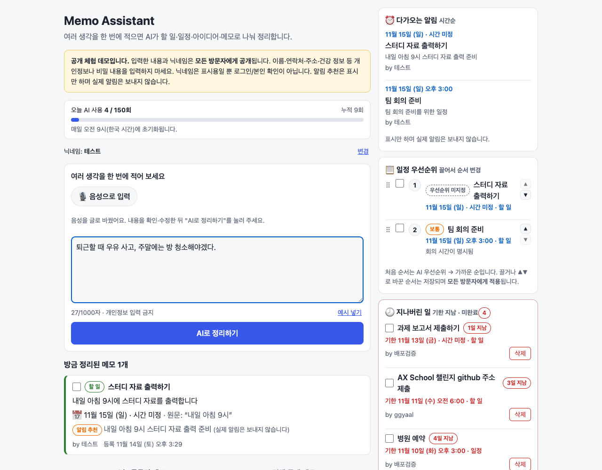

# 메모비서 (Memo Assistant)

> AX School **Build Your Agent** 과제 — 떠오른 생각을 **글이나 음성**으로 한 번에 던지면 AI 에이전트가 메모로 나눠 정리하고 공유하는 **공개 체험 프로토타입**. 핵심은 할 일 관리보다 **기록의 진입장벽을 낮추는 것**입니다.

**데모: https://memo-assistant.ggyaal.workers.dev** (로그인 없이 사용) · 소개 글 초안: [docs/AX_CHALLENGE_SUBMISSION.md](docs/AX_CHALLENGE_SUBMISSION.md)



> ⚠️ **모든 메모와 닉네임은 모든 방문자에게 공개됩니다.** 개인정보나 비밀 내용을 입력하지 마세요. 닉네임은 표시용이며 로그인이나 본인 확인이 아닙니다. '익명'이어도 입력 내용 자체는 그대로 공개됩니다. 전화번호·이메일·주민번호·카드번호·'비밀번호: …' 같은 형식은 자동으로 막지만, 이름·주소 같은 다른 개인정보까지 모두 걸러내지는 못합니다.

## 누구를 위한 에이전트인가 / 무엇을 대신하나
- **대상**: 떠오르는 할 일·약속·아이디어를 한 문장에 몰아 적는 사람(학생, 직장인, 팀 프로젝트 참여자).
- **대신하는 일**: 뒤섞인 입력을 의미 단위로 **나누고**, `할 일/일정/아이디어/메모`로 **분류**하고, "내일 오후 3시" 같은 표현을 **요청 당시 한국 날짜 기준의 실제 일시로 해석**하고, 알림이 필요해 보이는지 **추천**한 뒤, 원문과 함께 **저장**합니다.

## 지금 되는 기능 / 아직 안 되는 기능
"확인됨"은 자동 테스트나 로컬 실행으로 직접 확인했다는 뜻입니다. 자세한 근거는 [docs/PROGRESS.md](docs/PROGRESS.md)에 있습니다.

| 기능 | 상태 |
|---|---|
| 닉네임 입력, 공개 고지, 개인정보 입력 금지 안내 | 확인됨 (운영 브라우저) |
| **음성 입력**: 버튼으로 녹음 시작/종료(최대 60초) → Workers AI Whisper로 글 변환 → 입력창에서 확인·수정 후 정리. 음성 파일은 저장하지 않음 | 확인됨 (운영: Chrome webm, 로컬: Safari 계열 mp4·wav 변환). 권한 거부·미지원 브라우저 안내 포함 |
| **민감정보 차단**: 전화번호·이메일·주민번호·카드번호·비밀번호 값 감지 시 화면 경고 + 서버가 AI 호출 전 거부 | 확인됨 (테스트 + 운영) |
| 하나의 입력을 여러 메모로 분리·분류하고 Flue Tool(`save_memos`)로 D1에 저장 | 확인됨 — mock 모델 테스트 + **실제 Workers AI(glm-4.7-flash) 로컬 호출** |
| 원문 보존, 각 메모의 `source_id` 연결 | 확인됨 |
| "내일 오후 3시"를 요청 시점 KST 기준으로 해석, 시각이 없는 표현("오늘")이나 기한 없는 메모에 일시를 만들지 않음 | 확인됨 (실제 AI + 서버 측 보정) |
| 같은 `requestId` 재요청 시 중복 저장·AI 재호출 없음 | 확인됨 |
| 오늘(KST) 등록 메모 / 전체 공개 메모 목록, 종류 필터, 더 보기 | 확인됨 (API) |
| 서버 측 입력 검증(닉네임 20자, 본문 1,000자, 요청 크기 8KB) | 확인됨 |
| 요청 제한(클라이언트별 분당 5회, 하루 전체 150회), 다른 사이트에서 보낸 요청 차단 | 확인됨 |
| 모델 오류·할당량 초과·시간 초과·DB 오류를 화면에 오류로 표시 | 확인됨 (API 응답) |
| 화면에 AI 사용량 표시: 오늘 사용 / 하루 한도, 누적 사용 횟수 (매일 오전 9시 KST 초기화) | 확인됨 (테스트 + 운영 반영) |
| 사이드 패널: 다가오는 **알림 추천을 시간순**으로, 기한 있는 메모를 **AI 우선순위(높음/보통/낮음) → 가까운 순**으로 순위 표시 | 확인됨 (테스트 + 운영 실제 AI). 실제 알림은 보내지 않음 |
| 우선순위 목록 **드래그 정렬**(▲▼ 버튼 포함). 저장되며 AI가 덮어쓰지 않음 | 확인됨 (테스트 + 로컬 브라우저 + 운영 반영) |
| 메모 **완료 체크 + 취소선**. 새로고침 후 유지, 해제하면 복구 | 확인됨 (테스트 + 로컬 브라우저 + 운영 반영) |
| **'지나버린 일'**: 기한이 지난 미완료 메모를 따로 표시하고 삭제(숨김) | 확인됨 (테스트 + 로컬 브라우저 + 운영 반영) |
| 실제 모델의 분류·우선순위 일관성 | 실행마다 카테고리·알림 추천·우선순위가 달라질 수 있음 (Phase 2에서 측정) |
| Cloudflare 배포 (Workers 무료 플랜) | 확인됨 — https://memo-assistant.ggyaal.workers.dev 에서 실제 AI 요청까지 확인 |
| 👍/👎 평가, 작성자 필터 UI | 아직 안 됨 |
| 실제 알림 발송, 로그인, 개인 메모, 메모 내용 수정, 검색 | **이번 범위 아님(구현하지 않음)**. 알림은 "추천" 배지만 표시합니다. |
| 모델이 시각을 빠뜨린 경우 고치기 | 안 됨 — 예: "내일 아침 9시"가 "시간 미정"으로 저장된 사례(운영). 수정 기능 없음 |

## 구조
```text
브라우저 (React)
  │ POST /api/memos {nickname, text, requestId}
  ▼
Cloudflare Worker — Hono (src/app.ts, src/server/routes.ts)
  ├─ 입력 검증 · 중복 requestId 확인 · 요청 제한 (D1 usage_counters)
  │
  ├─ init(MemoOrganizer).dispatch()  ← 서버가 정한 값은 initialData로 전달
  ▼
Flue 에이전트 MemoOrganizer (Durable Object, src/agents/memo-organizer.ts)
  ├─ Workers AI: @cf/zai-org/glm-4.7-flash  (원문 + KST 날짜표)
  └─ Tool 호출 save_memos (src/tools/save-memos.ts)
        └─ sanitizeMemo() 보정 → D1 batch: sources 1건 + memos N건
  ▼
D1 → 응답 → 결과 카드 / "오늘 등록된 메모" · "전체 공개 메모" · 사이드 패널(알림·우선순위·지나버린 일)

🎙️ MediaRecorder ─ POST /api/transcribe (audio/*) ─▶ Workers AI @cf/openai/whisper-large-v3-turbo
                                                     └▶ 텍스트만 응답(음성·텍스트 저장 안 함) → 입력창
```
- 에이전트는 HTTP로 직접 노출하지 않습니다. `/api/memos`만 거치므로 검증과 요청 제한을 우회할 수 없습니다.
- 모델은 닉네임, `source_id`, 생성 시각 같은 값을 정하거나 바꿀 수 없습니다.

## 기술
React 19 + TypeScript + Vite 8 · Flue 2.3 (`'use agent'`, `useTool`) · Cloudflare Workers + Durable Objects(SQLite) · Workers AI · D1 · Wrangler · Vitest + Miniflare

## 로컬 실행
필요: Node.js 22.19 이상, Cloudflare 계정(무료 플랜).

```bash
npm install
npx wrangler login                 # 실제 AI를 호출할 때만 필요
npm run db:migrate:local           # 로컬 D1(.wrangler/)에 스키마 적용
```

| 명령 | 설명 |
|---|---|
| `npm run dev:offline` | AI 없이 화면·D1·목록 API를 로컬에서 실행합니다. Neuron을 쓰지 않습니다. AI 정리 요청은 오류로 표시됩니다. |
| `npm run dev` | 실제 Workers AI를 호출합니다. **로컬 실행이어도 내 Cloudflare 계정의 무료 Neuron(하루 10,000)을 소모합니다**(1건당 약 36). 계정에 workers.dev 서브도메인이 등록되어 있어야 합니다. |

브라우저에서 http://localhost:5173 을 엽니다.

## 테스트
```bash
npm run check:types   # 타입 검사 (클라이언트 + Worker)
npm test              # 단위 + 로컬 D1 통합 + Flue 에이전트(faux 모델) 테스트
npm run test:worker   # 빌드한 Worker를 workerd + 로컬 D1에서 실행 (AI 스텁)
```
테스트는 실제 AI를 호출하지 않습니다. 에이전트 테스트는 Pi faux provider로 모델 응답을 스크립트로 정해 두고, 실제 Flue 런타임과 Tool, 로컬 D1을 그대로 실행합니다.

## 설정 (환경 변수 이름만 — 비밀값 없음)
`wrangler.jsonc`의 `vars`로 조정합니다. 비밀값(secret)은 필요하지 않습니다.
- `MEMO_MODEL`: 무료 플랜에서 쓸 수 있고 function calling을 지원하는 Workers AI 모델
- `RATE_LIMIT_PER_MINUTE`, `DAILY_AI_LIMIT`: AI 정리 요청 제한 값
- 바인딩: `AI`(Workers AI), `DB`(D1). Flue가 Durable Object 바인딩을 자동 생성합니다.

## 무료 서비스 의존성과 사용 제한
| 항목 | 한도 | 앱의 대응 |
|---|---|---|
| Workers AI | 하루 10,000 Neurons (00:00 UTC = 오전 9시 KST 초기화) | AI 정리 하루 150회(1건 약 36 Neurons 실측), 음성 변환 하루 60회(1분 약 47 Neurons), 클라이언트별 분당 제한. 초과 시 안내 |
| Workers / Durable Objects / D1 | 무료 플랜 한도 | 운영에서 호출당 CPU 10ms를 넘는 경우가 관찰됐지만 오류는 없었음([PROGRESS](docs/PROGRESS.md) R5) |
| 음성 변환 | 최대 60초, 2MB | 녹음 자동 종료, 서버에서 크기 검사 |

## 보안·공개 저장소 주의
- API 키, 토큰, `.env`, `.dev.vars`, `.wrangler/`(로컬 DB)는 `.gitignore`에 포함되어 있으며 **커밋하지 않습니다.** 이 앱은 Workers AI 바인딩을 쓰므로 별도 API 키가 필요하지 않습니다.
- 비밀값이 필요해지면 `npx wrangler secret put`을 사용합니다.
- 모델이 생성한 문자열은 HTML이 아닌 텍스트로만 표시합니다.
- **공유 게시판 편집**: 드래그 순서, 완료 체크, '지나버린 일' 삭제는 로그인 없이 **모든 방문자에게 똑같이 적용**됩니다(누구나 바꿀 수 있음). 삭제는 기한이 지난 미완료 메모만 가능하고, DB에서 지우지 않고 숨기기만 합니다(soft delete). 편집 요청도 같은 출처의 JSON 요청만 받고, 클라이언트당 분당 30회로 제한합니다.
- 클라이언트 IP는 저장하지 않고, 요청 제한용 해시만 잠시 보관합니다.
- API는 JSON 요청과 같은 출처만 허용하고, API·정적 자산 모두 보안 헤더(CSP 등)를 보냅니다. 점검 내역은 [docs/PROGRESS.md](docs/PROGRESS.md) §5에 있습니다.

## 과제 제출
- 이 저장소를 GitHub에 **Public**으로 공개해 제출합니다.
- 제출 전 확인: `git status`에 `.env`, `.dev.vars`, `.wrangler/`가 없어야 합니다.
- 배포 방법(이미 배포됨): `npx wrangler d1 migrations apply DB --remote` → `npm run build && npx wrangler deploy`
- 포크해서 다른 계정에 배포할 때는 `npx wrangler d1 create memo-assistant`로 만든 ID를 `wrangler.jsonc`의 `database_id`에 넣으세요.

## 문서
- [docs/AX_CHALLENGE_SUBMISSION.md](docs/AX_CHALLENGE_SUBMISSION.md): 사이드 프로젝트 소개 글 초안(운영 실측 예시)
- [docs/AX_CHALLENGE_DEMO.md](docs/AX_CHALLENGE_DEMO.md): 데모 녹화 순서·테스트 입력·캡처 가이드
- [docs/SPEC.md](docs/SPEC.md): 제품 명세
- [docs/IMPLEMENTATION.md](docs/IMPLEMENTATION.md): 구현 지시
- [docs/PROGRESS.md](docs/PROGRESS.md): 진행 기록, 이슈, 검증 결과
- [CLAUDE.md](CLAUDE.md): Claude Code 작업 지침

## License
[LICENSE](LICENSE)
