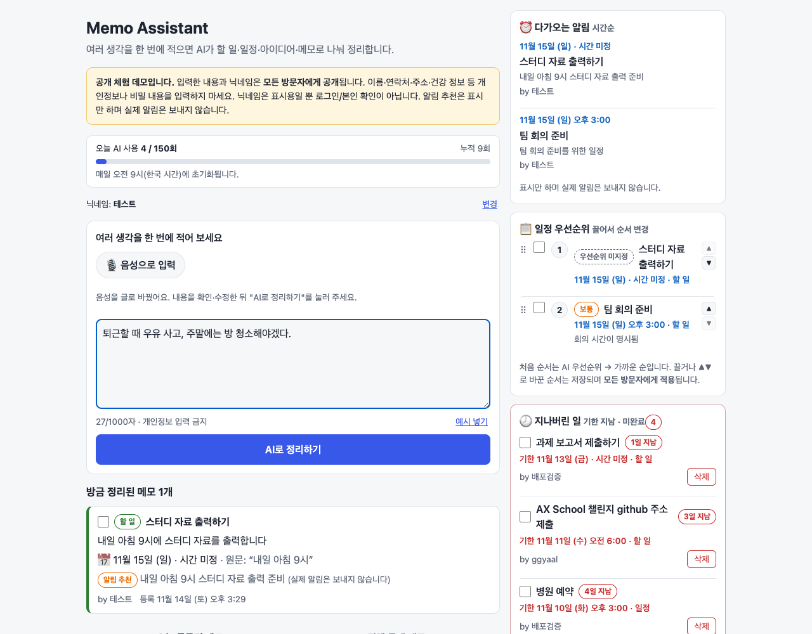

# 메모비서 (Memo Assistant)

> AX School **Build Your Agent** 과제 — 떠오른 생각을 **글이나 음성**으로 한 번에 던지면 AI 에이전트가 메모로 나눠 정리하고, 일정·반복 일정은 캘린더와 **Discord 알림**으로 챙겨 주는 프로토타입. 핵심은 할 일 관리보다 **기록의 진입장벽을 낮추는 것**입니다.

**데모: https://memo-assistant.ggyaal.workers.dev** · 소개 글 초안: [docs/AX_CHALLENGE_SUBMISSION.md](docs/AX_CHALLENGE_SUBMISSION.md) · 진행 기록: [docs/PROGRESS.md](docs/PROGRESS.md)



> ⚠️ 로그인 없이 쓰는 **「익명의 스케줄」은 공개 공간**입니다. 메모와 닉네임이 모든 방문자에게 보이므로 개인정보·비밀 내용을 입력하지 마세요(닉네임은 본인 확인이 아닙니다). 전화번호·이메일·주민번호·카드번호·"비밀번호: …" 형식은 자동으로 막지만, 이름·주소 같은 다른 개인정보까지 모두 걸러내지는 못합니다. 로그인하면 **나만 보는 개인 공간**을 씁니다.

## 누구를 위한 에이전트인가 / 무엇을 대신하나
- **대상**: 떠오르는 할 일·약속·아이디어를 한 문장에 몰아 적거나 말하는 사람(학생, 직장인, 팀 프로젝트 참여자).
- **대신하는 일**: 뒤섞인 입력을 의미 단위로 **나누고**, `할 일 / 일정 / 아이디어 / 메모`로 **분류**하고, "내일 오후 3시"·"매주 월수금" 같은 표현을 **한국 시간 기준 실제 날짜·반복 규칙으로 해석**하고, 중요도와 알림 필요 여부를 정한 뒤 원문과 함께 **저장**합니다. 개인 공간에서는 정한 시각에 **Discord DM으로 알려** 줍니다.

## 기능 한눈에 보기
운영(https://memo-assistant.ggyaal.workers.dev)에 모두 반영되어 있습니다. 확인 근거(테스트·실제 AI·브라우저·운영 확인)는 [docs/PROGRESS.md](docs/PROGRESS.md)의 이슈 번호(I·R)에 있습니다.

### 1. 입력과 AI 정리
| 기능 | 설명 |
|---|---|
| 글·음성 입력 | 입력 카드는 처음에 **접혀 있고** 음성 버튼만 보입니다(버튼 문구는 「주저리.. 주저리..」「그 뭐더라...」 등 8개 중 무작위). 「⌨️ 글로 쓰기」로 펼쳐 글을 씁니다. |
| 음성 → 글 | 최대 60초 녹음 → Workers AI Whisper가 글로 변환. 음성 파일과 변환 글은 서버에 저장하지 않습니다. |
| 바로 보내기 | 음성 버튼 옆 체크(기본 켜짐). 켜져 있으면 변환된 글을 바로 정리하고, 접힌 카드는 펼치지 않고 한 줄 진행 상태만 보여 줍니다. 끄면 글을 검토한 뒤 보냅니다. 공개 공간에서 개인정보로 보이면 보내지 않고 경고합니다. |
| 메모 분리·분류 | 한 입력을 여러 메모로 나누고 4가지로 분류합니다. 날짜가 있다고 모두 일정이 아닙니다("오후 3시까지 보고서 제출" = 할 일, "오후 3시 발표" = 일정). |
| 날짜·시각 해석 | "오늘/내일/모레/금요일/다음 주 화요일"을 **요청 당시 한국 날짜**로 서버가 계산합니다. 시각이 없는 표현이나 기한 없는 메모에 시각을 지어내지 않습니다. |
| 확인 질문 | 날짜·시각·반복이 정말 불분명할 때만 저장 **전에** 한 번에 하나씩(최대 3개) 묻습니다: "오전/오후?"(예: "내일 3시"), "다음 주 언제?", "매주 반복?"("월 화 목 운동"). 버튼·날짜/시각 선택으로 답하고, 「이번 질문 건너뛰기」(그 값만 미정), 「추가 질문 안 하기 · 지금 저장」(남은 질문 생략), 「저장 취소」(저장·알림 없음, 글은 그대로)를 고를 수 있습니다. 질문은 서버 규칙이 만들고 답변에는 **AI를 다시 부르지 않습니다**. 명확한 입력은 지금처럼 바로 저장됩니다. 비용 측정: [docs/AI_CLARIFICATION_BUDGET.md](docs/AI_CLARIFICATION_BUDGET.md) |
| 실시간 진행 표시 | 입력 확인 → AI 분석 → 메모 N개 발견 → 저장 → 완료를 서버가 실제로 도달한 단계만 보여 줍니다(SSE). 분석 중 「취소」하면 그 요청의 에이전트를 중단합니다. |
| 방금 정리된 메모 | 결과는 접힌 채로 나오고, 펼치면 길 때 안에서 스크롤됩니다. |
| 중복 방지·사용량 | 같은 요청을 다시 보내도 AI를 다시 부르지 않습니다(확인 대기 중인 초안도 재사용). 오늘 AI 요청 횟수, 무료 예산(예상), **메모 정리 실측 Neurons**(실제 토큰 × 공식 단가), 음성 사용 시간을 보여 줍니다. |

### 2. 반복·여러 날짜 일정
| 기능 | 설명 |
|---|---|
| 반복 인식 | "매일", "매주 월수금 오후 7시", "격주 화요일", "매월 15일", "평일마다", "주말마다", "이제부터 월, 화, 금" → 반복 일정. |
| 여러 날짜 한 번씩 | "다음 주 월, 목", "이번 주말" → 그 날짜들만 한 번씩. |
| 불분명하면 확인 | "월 화 목 운동", "평일 아침", "주말에 청소"처럼 반복인지 분명하지 않으면 저장 전에 「매주 반복 / 이번만」을 묻습니다(건너뛰면 카드에서 나중에 고를 수 있음). |
| 회차 관리 | 반복 일정은 메모 한 개(규칙 하나)로 관리하고, 회차마다 완료를 따로 체크합니다. 목록에는 "이번 회차", 캘린더에는 회차마다 표시됩니다. 통째로 "지나버린 일"이 되지 않습니다. |
| AI 추가 호출 없음 | 반복·날짜 계산은 저장된 문구로 서버가 합니다. 모델이 문구를 빠뜨리면 메모 내용이나(메모가 하나면) 입력 원문에서 직접 읽습니다. |

### 3. 보기·정리
| 기능 | 설명 |
|---|---|
| 캘린더 (첫 탭) | 월요일 시작 월간 달력. 이전·다음 달·오늘, 분류 필터(기본 할 일·일정), 날짜를 누르면 그날 메모 카드, 현재 달에는 오늘 요약. 휴대폰에서는 개수 배지. |
| 메모 목록 | 「오늘 등록된 메모 / 전체 메모」, 종류 필터, 더 보기. **전체 메모는 날짜별로 묶어** 보여 주고, 등록일(기본) 또는 일정 날짜로 묶을 수 있습니다. |
| 사이드 카드 | ⏰ 다가오는 알림(시간순) · 📋 일정 우선순위(AI 중요도 → 가까운 순, **드래그·▲▼로 순서 변경**) · 💡 아이디어 목록 · 🕗 지나버린 일. 처음에는 「다가오는 알림」만 펼쳐지고, 접기/펼치기는 기억됩니다. 넓은 화면에서는 화면에 고정되고, 길면 카드 안에서 스크롤됩니다. |
| 완료 체크 | 체크하면 취소선. 반복 일정은 그 회차만 완료됩니다. |
| 수정 | 「✏️ 수정」으로 제목·내용·분류·중요도·날짜·시각·반복(매일·평일·주말·매주·격주·매월)을 고칩니다. 분류를 바꿔도 AI를 다시 부르지 않고, 기한을 바꾸면 "N분 전" 알림이 따라갑니다. |
| 삭제·되돌리기 | 「🗑 삭제」 → 확인 → 숨김 처리 후 「되돌리기」. 개인 공간은 모든 메모, 공개 공간은 **이 브라우저에서 쓴 메모만** 지울 수 있습니다(남의 메모는 기한 지난 미완료 메모만). 삭제하면 알림 예약도 꺼집니다. |

### 4. 로그인·개인 공간·설정
| 기능 | 설명 |
|---|---|
| 두 공간 | 로그인 없이 「익명의 스케줄」(공개, 모두 함께 씀) 또는 소셜 로그인으로 **개인 공간**(본인만). 서버가 세션으로 공간을 정하며 두 공간의 데이터는 섞이지 않습니다. |
| 소셜 로그인 | Discord(운영 사용 중), Google·카카오(키가 없어 "준비 중"). OAuth Authorization Code + PKCE, 세션 쿠키는 `__Host-` HttpOnly Secure. 계정은 이메일로 자동으로 합치지 않습니다(명시적 연결만). |
| ⚙️ 설정 | 닉네임, 연결 계정, 알림 받을 곳(Discord / 카카오톡·Gmail은 준비 중), 자동 알림 기본값(N분 전, 날짜만 있는 메모 시각), 알림 말투. |

### 5. Discord 알림 (개인 공간)
| 기능 | 설명 |
|---|---|
| 켜기 | 알림 봇이 있는 Discord 서버에 가입해야 켤 수 있습니다(미가입이면 초대 링크 표시). 켤 때 **테스트 DM이 실제로 도착해야** 켜집니다. |
| 예약 | 메모 카드에서 알림 받을 곳·날짜·시각을 고르고 「30분 전·10분 전·정시」 버튼으로 채웁니다. 지금부터 4분 이후만 가능합니다. 반복 일정은 매 회차 "N분 전" 또는 정한 시각에 보냅니다. |
| 자동 예약 | AI가 알림을 추천한 메모와 반복 할 일·일정은 자동으로 예약됩니다(시각 없는 반복 일정은 오전 9시 또는 설정한 시각). 「다가오는 알림」에서 하나씩 끌 수 있고, 끈 알림은 다시 켜지지 않습니다. |
| 카드·말투 | Embed 카드(분류, 한국 시간 예정/마감, 알림 시점, 🔁 반복, 안내 문장, 「메모비서에서 확인하기」 버튼). 말투 4가지(친근한 비서·기본형·정중한 비서형·귀여운 말투)는 고정 문장이며 AI를 부르지 않습니다. |
| 정확·안전한 발송 | 매분 Cron이 다음 1분 안의 알림을 미리 가져와 **정각에** 보냅니다. 보내기 직전에 완료·삭제·채널 상태를 다시 확인하고, 같은 알림·같은 회차는 두 번 보내지 않습니다. 일시 오류는 최대 3회 다시 시도합니다. |

### 6. 아직 안 되는 것
- 카카오톡·Gmail 알림, Google·카카오 로그인(키 미설정), 주간 캘린더 보기, 반복 종료일("12월까지") 인식, 👍/👎 평가, 검색.
- 실제 모델의 분류·중요도는 실행마다 조금씩 달라질 수 있습니다(서버 보정으로 날짜·반복 계산은 일정함).

## 구조
```text
브라우저 (React)
  │ POST /api/memos  (Accept: text/event-stream → 진행 단계 SSE)
  ▼
Cloudflare Worker — Hono (src/app.ts, src/server/routes.ts)
  ├─ 세션 → 공간(개인/익명의 스케줄) · 입력 검증 · 개인정보 차단 · 요청 제한 · 중복 requestId
  ├─ init(MemoOrganizer).dispatch()  ← 서버가 정한 값은 initialData로만 전달
  ▼
Flue 에이전트 MemoOrganizer (Durable Object, src/agents/memo-organizer.ts)
  ├─ Workers AI @cf/zai-org/glm-4.7-flash (원문 + KST 날짜표)
  └─ Tool save_memos → sanitizeMemo()(날짜·반복 보정) → D1: sources 1건 + memos N건
  ▼
D1 ──▶ 목록 · 캘린더 · 사이드 카드 · 설정

🎙️ MediaRecorder → POST /api/transcribe → Whisper → 글만 응답(저장 안 함)
⏰ Cron(매분) → runDueReminders → Discord 봇 REST API로 DM (카드·말투는 템플릿, AI 없음)
```
- 에이전트는 HTTP로 직접 노출하지 않습니다. `/api/memos`만 거치므로 검증·요청 제한을 우회할 수 없습니다.
- 모델은 닉네임, 공간, `source_id`, 생성 시각 같은 값을 정하거나 바꿀 수 없습니다.
- 주요 D1 테이블: `sources`, `memos`(반복 규칙 `recurrence` 포함), `memo_drafts`(확인 질문 대기 초안, 30분), `memo_occurrences`(회차 완료), `notifications`·`reminder_deliveries`(알림·회차 중복 방지), `users`·`oauth_accounts`·`sessions`·`workspaces`, `memo_runs`(진행 중 요청). 마이그레이션 `migrations/0001`–`0015`는 모두 추가만 합니다.
- 확인 질문: `save_memos`가 서버 규칙(`src/shared/clarify.ts`)으로 질문이 필요한지 보고, 필요하면 메모 대신 **초안**만 저장합니다. 답변은 `POST /api/memo-drafts/:id/commit`에서 한 번만 저장되며(중복 확정 방지), 취소는 `DELETE /api/memo-drafts/:id`.

## 기술
React 19 + TypeScript + Vite 8 · Flue 2.3 (`'use agent'`, `useTool`, `useDataWriter`) · Cloudflare Workers + Durable Objects(SQLite) + Cron Triggers · Workers AI · D1 · Hono · Wrangler · Vitest + Miniflare

## 로컬 실행
필요: Node.js 22.19 이상, Cloudflare 계정(무료 플랜).

```bash
npm install
npx wrangler login                 # 실제 AI를 호출할 때만 필요
npm run db:migrate:local           # 로컬 D1(.wrangler/)에 스키마 적용
cp .dev.vars.example .dev.vars     # 로그인·Discord를 쓸 때만 값 입력 (커밋 금지)
```

| 명령 | 설명 |
|---|---|
| `npm run dev:offline` | AI 없이 화면·D1·API를 로컬에서 실행합니다. Neuron을 쓰지 않으며 AI 정리 요청은 오류로 표시됩니다. |
| `npm run dev` | 실제 Workers AI를 호출합니다. **로컬이어도 계정의 무료 Neuron(하루 10,000)을 씁니다**(1건 약 36). workers.dev 서브도메인이 필요합니다. |
| `npm run dev:cron` | 로컬 dev 서버의 알림 발송(Cron)을 1분마다 실행합니다(`vite dev`는 Cron을 스스로 돌리지 않음). |

브라우저에서 http://localhost:5173 을 엽니다.

## 테스트
```bash
npm run check:types   # 타입 검사 (클라이언트 + Worker)
npm test              # 단위 + 로컬 D1 통합 + Flue 에이전트(faux 모델) 테스트
npm run test:worker   # 빌드한 Worker를 workerd + 로컬 D1에서 실행 (AI 스텁)
```
테스트는 실제 AI를 호출하지 않습니다. 에이전트 테스트는 Pi faux provider로 모델 응답을 정해 두고 실제 Flue 런타임·Tool·로컬 D1을 실행합니다. 공간 격리(A/B 사용자·게스트), OAuth state/PKCE, 알림 중복 방지, 반복 회차 계산, 마이그레이션 데이터 보존 등을 다룹니다.

## 설정 (이름만 — 값은 저장소에 없음)
- **변수** (`wrangler.jsonc` `vars`): `MEMO_MODEL`, `RATE_LIMIT_PER_MINUTE`, `DAILY_AI_LIMIT`, `DAILY_AI_NEURONS`, `DISCORD_GUILD_ID`(알림 봇 서버), `DISCORD_SERVER_INVITE`, `PUBLIC_APP_URL`(카드 버튼 주소)
- **비밀값** (`npx wrangler secret put …`, 로컬은 `.dev.vars`): `DISCORD_CLIENT_ID`, `DISCORD_CLIENT_SECRET`, `DISCORD_BOT_TOKEN`, (선택) `GOOGLE_CLIENT_ID`, `GOOGLE_CLIENT_SECRET`, `KAKAO_REST_API_KEY`, `KAKAO_CLIENT_SECRET`
- **OAuth 리디렉션 URI**: `http://localhost:5173/api/auth/<provider>/callback`, `https://memo-assistant.ggyaal.workers.dev/api/auth/<provider>/callback`
- **바인딩**: `AI`(Workers AI), `DB`(D1), Flue가 만드는 Durable Object, Cron `* * * * *`

## 무료 서비스 의존성과 사용 제한
| 항목 | 한도 | 앱의 대응 |
|---|---|---|
| Workers AI | 하루 10,000 Neurons (오전 9시 KST 초기화) | 메모 정리: 하루 150회 **그리고** 입력 길이 기반 예상 비용 6,000. 음성: 실제 오디오 길이 기준 하루 30분(약 1,400). 나머지는 예비. 클라이언트별 분당 제한, 초과 시 안내. 알림·캘린더·반복 계산은 AI를 쓰지 않음 |
| Workers / Durable Objects / D1 | 무료 플랜 한도 | 호출당 CPU 10ms를 넘는 경우가 관찰됐지만 오류는 없었음([PROGRESS](docs/PROGRESS.md) R5) |
| Cron Triggers | 계정당 5개 | 1개 사용(매분 알림 발송) |
| 음성 변환 | 최대 60초 | 32kbps 녹음·60초 자동 종료, 서버 600KB·65초 초과 거부 |

## 보안·공개 저장소 주의
- API 키·토큰·`.env`·`.dev.vars`·`.wrangler/`(로컬 DB·백업)은 `.gitignore`에 있으며 커밋하지 않습니다. `.dev.vars.example`에는 이름만 있고 값이 들어가면 테스트가 실패합니다.
- 세션 토큰·OAuth state·작성자 키는 **SHA-256만** D1에 저장합니다. 공급자 액세스 토큰은 저장하지 않습니다.
- 모든 메모 쿼리는 서버 세션의 공간(`workspace_id`)으로 범위를 정하고, 다른 공간의 메모는 404로 숨깁니다.
- 상태를 바꾸는 API는 같은 출처의 JSON 요청만 받고(CORS 없음) 클라이언트당 분당 횟수를 제한합니다.
- 공개 공간 편집: 순서·완료는 모든 방문자에게 공유되고, 삭제는 내가 쓴 메모 또는 기한 지난 미완료 메모만 가능합니다. 삭제는 숨김(soft delete)이며 DB에서 지우지 않습니다.
- 모델이 만든 문자열은 HTML이 아닌 텍스트로만 표시하고, Discord 카드의 사용자 문구는 마크다운을 이스케이프하며 멘션을 막습니다.
- 클라이언트 IP는 저장하지 않고, 요청 제한용 해시만 잠시 보관합니다. API·정적 자산 모두 보안 헤더(CSP 등)를 보냅니다.

## 배포
```bash
npx wrangler d1 export memo-assistant --remote --output <백업 파일>   # 먼저 백업
npx wrangler d1 migrations apply memo-assistant --remote
npm run build && npx wrangler deploy
```
포크해서 다른 계정에 배포할 때는 `npx wrangler d1 create memo-assistant`로 만든 ID를 `wrangler.jsonc`의 `database_id`에 넣고, 위 비밀값과 변수를 설정하세요.

## 문서
- [docs/PROGRESS.md](docs/PROGRESS.md): 진행 기록, 이슈(I·R), 배포 기록, 검증 결과
- [docs/AX_CHALLENGE_SUBMISSION.md](docs/AX_CHALLENGE_SUBMISSION.md): 소개 글 초안 · [docs/AX_CHALLENGE_DEMO.md](docs/AX_CHALLENGE_DEMO.md): 데모 녹화 가이드
- [docs/SPEC.md](docs/SPEC.md): 제품 명세 · [docs/IMPLEMENTATION.md](docs/IMPLEMENTATION.md): 구현 지시
- [CLAUDE.md](CLAUDE.md): Claude Code 작업 지침

## License
[LICENSE](LICENSE)
